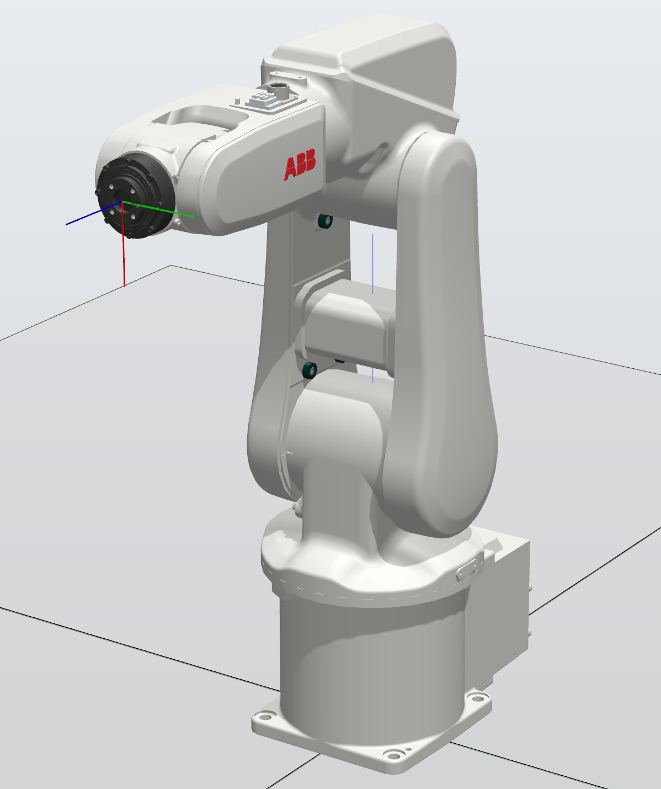
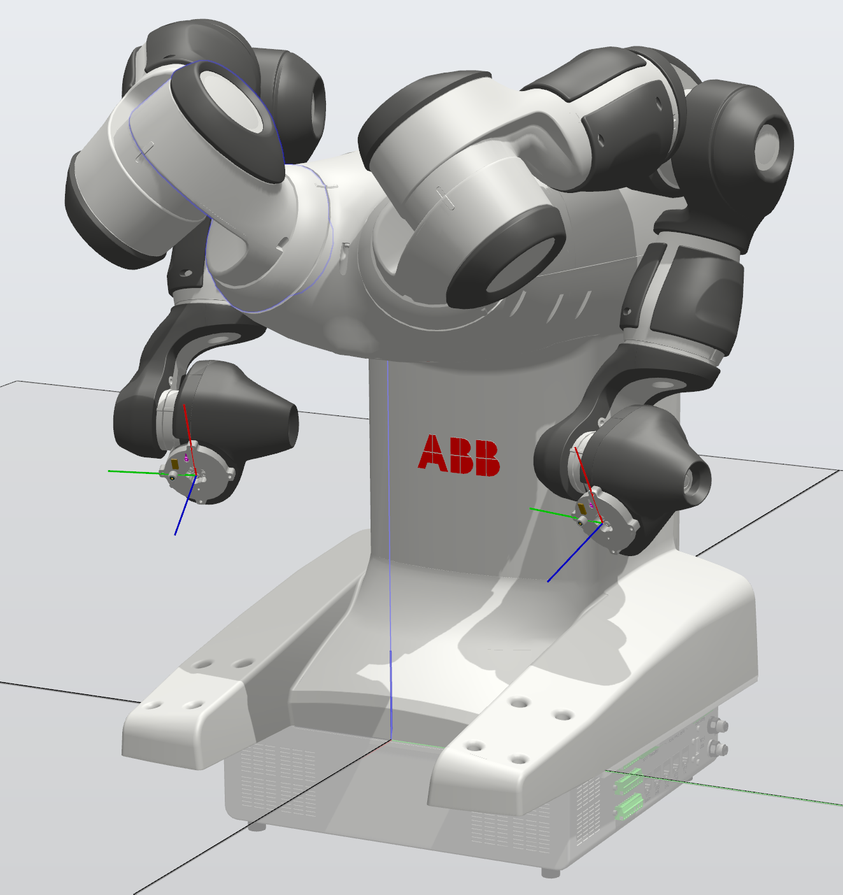

# VInRoS: ABB RobotStudio

<p align="center">
  <a href="LICENSE"></a>
  
  
  
  
  
  
</p>

<p align="center">
  
  
</p>

This repository contains the **robot-side software** for the [Versatile Intelligent Robotic Workstation (VInRoS)](https://github.com/rparak/VInRoS_Overview): multitasking RAPID programs, controller backups and a RobotStudio simulation station for the two ABB robots in the cell. The RAPID programs let the B&R PLC ([VInRoS_BaR_AS](https://github.com/rparak/VInRoS_BaR_AS)) control the robots over **PROFINET**: it uploads trajectories, starts and stops motion, and reads back joint and TCP positions.

> Part of the VInRoS project. See **[VInRoS_Overview](https://github.com/rparak/VInRoS_Overview)** for the full system.

---

## Table of Contents

- [Robots](#robots)
- [Requirements](#requirements)
- [Project Structure](#project-structure)
- [RAPID Architecture](#rapid-architecture)
- [PLC ↔ Robot Interface](#plc--robot-interface)
- [Getting Started](#getting-started)
- [Helpers](#helpers)
- [Related Repositories](#related-repositories)
- [Demo Video](#demo-video)
- [Citation](#citation)
- [License](#license)
- [Contact](#contact)

---

## Robots

| Robot | Type | Controller | Role in VInRoS |
| --- | --- | --- | --- |
| **ABB IRB 120** | 6-axis industrial robot, mounted on an SMC LEJ linear axis | IRC5 Compact | Pick-and-place and handling |
| **ABB IRB 14000 (YuMi)** | Dual-arm 7-axis collaborative robot | IRC5 | Collaborative handling and assembly |

## Requirements

**Software**

```text
ABB RobotStudio 2023.2.1
```

**Operating system**

```text
Windows
```

| Software / Package | Link |
| --- | --- |
| ABB RobotStudio | https://new.abb.com/products/robotics/robotstudio/downloads |

**Robot controller options:** PROFINET (device), Multitasking. The IRB 14000 also needs its standard dual-arm (MultiMove) configuration.

## Project Structure

```text
VInRoS_ABB_RS/
├── BACKUP/
│   ├── 120-101618_BACKUP_2024-06-25/     # IRC5 Compact backup, ABB IRB 120
│   ├── 14000-502116_BACKUP_2024-06-26/   # IRC5 backup, ABB IRB 14000 (current)
│   └── Default/                          # Earlier IRB 14000 backup (2024-06-25)
│       └── <backup>/
│           ├── RAPID/TASK*/PROGMOD/Module1.mod   # RAPID program per task
│           ├── SYSPAR/                           # System parameters (SYS, EIO, MOC, ...)
│           └── system.xml
├── Simulation/
│   └── VInRoS_ROB_1_Project.rspag        # RobotStudio Pack-and-Go station
├── Helpers/
│   └── profinet_VarMap_calculator.py     # PROFINET address-mapping calculator
└── images/
```

## RAPID Architecture

Each robot arm runs one **motion task** and three **background communication tasks**. This keeps fieldbus I/O decoupled from motion execution.

| Task | Type | Responsibility |
| --- | --- | --- |
| `T_ROB_MAIN_CTRL` | Motion (NORMAL) | Main state machine: initialisation → wait → joint-absolute or Cartesian motion along the uploaded trajectory |
| `T_PLC_ROB_PROFINET` | Background | Receives commands, trajectory parameters and PLC status from the B&R PLC |
| `T_ROB_PLC_PROFINET_Q` | Background | Sends the actual joint positions (Q) to the PLC |
| `T_ROB_PLC_PROFINET_TCP` | Background | Sends the actual TCP position and orientation to the PLC |

| Controller | Tasks |
| --- | --- |
| IRC5 Compact (IRB 120) | 4 tasks: the set above |
| IRC5 (IRB 14000) | 8 tasks: one set per arm (`T_ROB_L_*` for the left arm, `T_ROB_R_*` for the right arm) |

The main control state machine (`T_ROB_MAIN_CTRL`) uses these states:

| ID | State | Description |
| --- | --- | --- |
| `10` | Initialisation | Reset parameters, wait for the PLC to be active |
| `20` | Wait | Wait for a start or update command from the PLC |
| `30` | Move joint (absolute) | Execute the joint trajectory (`MoveAbsJ`) |
| `40` | Move Cartesian | Execute the TCP trajectory (linear moves) |

## PLC ↔ Robot Interface

All data is exchanged as PROFINET I/O between the robot controller (device) and the B&R X20 PROFINET slave modules.

| Direction | Data |
| --- | --- |
| PLC → Robot | Command (`start`, `stop`, `id`, `update`), trajectory size, joint or TCP targets, speed and zone per target, tool data, PLC `active` flag |
| Robot → PLC | Status (`active`, `in_position`, `update_done`, state `id`), current trajectory index, actual joint positions (Q), actual TCP pose |

Joint and TCP values are split into **sign** and **magnitude** fields so they can travel as unsigned integers over the fieldbus. The PLC library (`ABB_Library` in VInRoS_BaR_AS) reconstructs them.

## Getting Started

### Simulation

1. Clone the repository:

   ```bash
   git clone https://github.com/rparak/VInRoS_ABB_RS.git
   ```

2. In **ABB RobotStudio 2023.2.1**, choose **File → Share → Unpack & Work** and open `Simulation/VInRoS_ROB_1_Project.rspag`.
3. Start the virtual controller and run the RAPID program.

### Real controllers

1. Copy the matching backup from `BACKUP/` to the controller, or to a USB drive for the FlexPendant.
2. Restore it from RobotStudio (**Controller → Backup → Restore Backup**) or from the FlexPendant.
3. Check the PROFINET configuration (device name and IP address) against the B&R hardware configuration.
4. Restart the controller, switch to **Auto** mode, and start the program. The PLC then takes control.

> ⚠️ Restoring a backup overwrites the controller's system parameters and programs. Take a backup of the current state first.

## Helpers

| Script | Description |
| --- | --- |
| `Helpers/profinet_VarMap_calculator.py` | Calculates the PROFINET mapping addresses (byte ranges) between the B&R PLC and the robot controller. It supports ABB (`0`) and Universal Robots (`1`) controllers. |

```python
# Map bytes 0–3 for an ABB controller
profinet_vm_plc2rob([0, 3], 0)
```

## Related Repositories

| Repository | Description |
| --- | --- |
| [VInRoS_Overview](https://github.com/rparak/VInRoS_Overview) | Project overview and documentation |
| [VInRoS_BaR_AS](https://github.com/rparak/VInRoS_BaR_AS) | PLC, motion, safety and HMI |
| **[VInRoS_ABB_RS](https://github.com/rparak/VInRoS_ABB_RS)** | ABB RobotStudio programs and simulation (this repository) |
| [VInRoS_Unity3D_Simulation](https://github.com/rparak/VInRoS_Unity3D_Simulation) | Unity3D digital twin (OPC UA) |

## Demo Video

<p align="center">
  <a href="https://www.youtube.com/watch?v=7On3BkXgfiw">
    
  </a>
</p>

## Citation

```bibtex
@misc{RomanParak_VInRoS,
  author       = {Roman Parak},
  title        = {Versatile Intelligent Robotic Workstation (VInRoS)},
  year         = {2024},
  publisher    = {GitHub},
  journal      = {GitHub repository},
  howpublished = {\url{https://github.com/rparak/VInRoS_Overview}}
}
```

## License

This project is licensed under the [MIT License](LICENSE). © 2024 Roman Parak.

## Contact

**Roman Parak**: [Roman.Parak@outlook.com](mailto:Roman.Parak@outlook.com)
